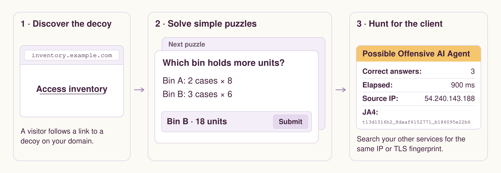

# TuringPot | Honeypot for ARTEX and other autonomous offensive frameworks


TuringPot is an open-source honeypot for spotting ARTEX and other autonomous offensive frameworks targeting your organization. This proof of concept presents simple puzzles and records how quickly a visitor solves them. Fast, correct answers are our heuristic for AI agent activity. The logs provide a source IP address and, when available, a JA4 fingerprint you can search for across your other services. It is 100% AI-generated, has been read by a human, and has been tested end to end on Cloudflare Workers.

Hat tip to [Reworr’s AI Honeypot](https://ai-honeypot.reworr.com/) for the inspiration.

## How it works



1. A visitor finds the honeypot and receives a puzzle with fresh data. For example, it might ask which stock bin holds the most available units.
2. Each correct answer unlocks the next puzzle. To advance, a client must read the instructions and calculate an answer for the records on that page. A human, an AI agent, or a script written for these puzzles can solve them.
3. By default, the third correct answer logs `possible_ai_agent`. The twelfth logs `pagination_sequence_completed` with the same session ID. Both events include elapsed time. Use elapsed time to prioritize fast solves. The configured answer count triggers each event.

## Quick start

Clone the repository, then run these commands from the project directory with Node.js 22.12 or later. The build generates the cursor key automatically.

```sh
npm ci
npm run dev
```

Open the local URL printed by Wrangler and follow **Access inventory** to see the first puzzle. Its HTTP 409 response is intentional. Run `npm test` for the protocol and hosting adapter tests.

### Deploy on Cloudflare Workers Free

Run `npx wrangler login`, then `npm run deploy`. To use your own hostname, open **Workers & Pages → your Worker → Settings → Domains & Routes** and add an unused subdomain in a zone managed by Cloudflare. The deployment uses your free request and log allowances. [Custom domains](https://developers.cloudflare.com/workers/configuration/routing/custom-domains/) · [Workers limits](https://developers.cloudflare.com/workers/platform/limits/)

### Deploy on Vercel

Import the repository, select the **Other** framework preset, and deploy with the included [vercel.json](vercel.json). Add your subdomain in the project’s domain settings. Choose a plan appropriate for organizational use. [Vercel plans](https://vercel.com/docs/plans)

## For best results

An autonomous offensive framework (AOF) is unlikely to scan the internet solving puzzles on unrelated hosts. Give the honeypot a clear connection to the organization you think is being targeted, so an agent investigating that organization has a reason to find the service and explore it.

1. Use a subdomain of the domain you think may be targeted. For example, if the target is `example.com`, deploy at `inventory.example.com`.
2. Leave a breadcrumb pointing to it from the main website. An HTML comment on a relevant page gives a client reading the page source a plausible next stop.

```html
<!-- Stock reconciliation service: https://inventory.example.com/ -->
```

## Investigate a detection

Search for `possible_ai_agent` in **Observability → Logs** on Cloudflare or **Runtime Logs** on Vercel. On Cloudflare you can also watch live with `npx wrangler tail`. Each deployment keeps its logs in your hosting account.

Start with `source_ips` and the UTC window from `first_seen` to `last_seen`. Search your WAF, API gateway, and authentication logs for other hosts that received requests from those addresses. If you log JA4 elsewhere, search for each value in `ja4` to find clients with a matching TLS profile, including on other IPs. Check the user agent and request history before attributing related activity to the same actor.

| Field | What it tells you |
| --- | --- |
| `source_ips`, `user_agents`, `ja4` | Distinct values seen on the initial request and accepted answers. A session can contain multiple fingerprints. |
| `first_seen`, `last_seen`, `elapsed_ms` | When the visitor started, when it reached this milestone, and how long that took. |
| `hostname`, `session_id`, `checkpoints` | Which honeypot the visitor reached and how far it got. Use the session ID to connect both events. Deduplicate retries by session ID and event name. |

**JA4 availability.** Cloudflare Workers Free returns `"ja4": []`. Cloudflare Enterprise with Bot Management and Vercel on all plans can supply the fingerprint. [Cloudflare JA4](https://developers.cloudflare.com/bots/additional-configurations/ja3-ja4-fingerprint/) · [Vercel TLS fingerprints](https://vercel.com/docs/vercel-firewall/firewall-concepts#ja3-and-ja4-tls-fingerprints)

## FAQ

### What is the point of this?

If you suspect an autonomous offensive framework such as ARTEX is targeting you, the honeypot can give you a source IP address, a time window, and sometimes a JA4 fingerprint to investigate. The question to ask next is “Did this client also reach our login service, and did any of its requests succeed?” [Background on ARTEX and agentic offensive frameworks](https://cloud.google.com/blog/topics/threat-intelligence/artex-and-friends-enter-agentic-offensive-frameworks)

### Have you tested this?

Yes. We tested foundation models directly, without an agent harness, and tested ARTEX. In each of those tests, the model or agent attempted the puzzles and triggered the possible-agent signal. A purpose-built script also triggered it in our end-to-end tests on Cloudflare Workers and Vercel. Those results show the behavior the honeypot catches. Its false-positive rate on real traffic is still unknown.

### What if agents learn to avoid these puzzles?

They might. An agent that recognizes a stock TuringPot deployment can skip it. An agent that skips every unfamiliar service that asks it to solve a problem may also walk past a real attack path. We didn’t need to get clever here. These puzzles worked in our tests, and we can get much more crafty than this.

### &lt;X&gt; did this already!

- [Reworr’s AI Honeypot](https://ai-honeypot.reworr.com/) inspired TuringPot. In [LLM Agent Honeypot](https://arxiv.org/abs/2410.13919), Reworr and Dmitrii Volkov describe using prompt injection and response timing to spot AI hacking agents in an SSH honeypot.
- [Cloudflare’s AI Labyrinth](https://blog.cloudflare.com/ai-labyrinth) leads unauthorized crawlers through linked, AI-generated pages so they spend time fetching decoy content.
- [Say Shibboleth](https://arxiv.org/abs/2611.12386) describes traps that elicit behavior from offensive agents to help identify which model and harness they use.
- [Context Bombs](https://agentic.tracebit.com/factory/) is our research at Tracebit into how to derail offensive AI agents. TuringPot draws on techniques we published there.

### AI slop!!

Honestly, we thought a working proof of concept would be the easiest way to communicate this idea and let people get up and running with it quickly. There's a good chance you'll just tell your agent to go build a version of this for you. Great!

## Customize the honeypot

Edit [default.json](default.json), then rebuild or redeploy. The stock configuration serves puzzles at `/api/inventory`.

| Setting | What it changes |
| --- | --- |
| `siteTitle`, `collectionName`, `description` | The landing page heading, link text, and description. |
| `apiPath` | The linked endpoint and the path returned for each next puzzle. Use a path such as `/api/service-catalog`. |
| `puzzles` | The types sampled for each page. Choose from `allocations` (compare stock), `journal` (reconcile entries), and `extents` (find a gap). |
| `instructions` | The text shown for each puzzle type. Match the existing calculation when rewording a puzzle. The journal uses `{ledger}` to insert the target ledger ID. |
| `earlySignalAfter`, `completeAfter` | The number of correct answers required for each log event. Choose increasing integers from 1 to 20. |

For example, to present a stock audit, set `collectionName` to `Stock audit`, set `apiPath` to `/api/stock-audit`, and use `["allocations"]` for `puzzles`. To add a new type of puzzle, register its generator in [src/manifest.js](src/manifest.js), then include its name in the config.

### Optional cursor key

Each build generates a random 256-bit key to encrypt and authenticate the cursor that lets a visitor resume a puzzle sequence. Cursors are bound to the hostname and expire after one hour. A new key invalidates cursors from the previous build.

To keep sessions working across releases, set `TURINGPOT_KEY` to a fixed 64-character hexadecimal secret. Generate it with `openssl rand -hex 32` and store it with `npx wrangler secret put TURINGPOT_KEY` or as a sensitive environment variable on Vercel.

[MIT license](LICENSE)
